# Testing GraniteAgent

How `granite` is tested: its own suite, its gated build of real output, and prompts run through
[Craft](https://github.com/riteshpakala/Craft) on a Mac with Craft's own local model, each logged below verbatim with
what came out. A prompt is run as a person would type it, in a project folder, with `$` naming the agent; nothing is
edited between the prompt and the screenshots. A test that needs a server uses mock backend responses, never a live
service.

## The suite

```
swift test                                  # the record, the schema, the lines, the files, a call through the roster
GRANITE_BUILD=1 swift test --filter GraniteBuildTests   # the output built for real (gated, minutes)
```

## Prompts run on this Mac

Setup: MacBook Pro M4 Max (128 GB), macOS 27, Xcode 27.1, Craft built from `main`, the model Craft loads
(`rao-studios/Qwen3-Coder-Next-REAP-48B-A3B-mlx-4bit`), permission mode bypass, the agent installed from this repository
with `craft agents add`.

### 1. A new iOS and macOS app, Hearth, in a folder that holds only its build command

*2026-11-01 · Qwen3-Coder-Next-REAP-48B-A3B-mlx-4bit · 1523 s*

**The prompt**, verbatim:

```text
$granite make a new iOS and macOS app here called Hearth, bundle id nyc.rao.hearth: a cozy recipe-sharing community app. Just the project and its foundation for now.
```

**The call the model wrote** to `granite`:

```json
{
  "bundleId": "nyc.rao.hearth",
  "make": "project",
  "name": "Hearth"
}
```

**What `granite` wrote** (28 files): `Hearth.xcodeproj/project.pbxproj`, `Hearth.xcodeproj/project.xcworkspace/contents.xcworkspacedata`, `Hearth.xcodeproj/xcshareddata/xcschemes/Hearth-iOS.xcscheme`, `Hearth.xcodeproj/xcshareddata/xcschemes/Hearth-macOS.xcscheme`, `Shared/App.swift`, `Shared/AppDelegate.swift`, `Shared/Assets.xcassets/Contents.json`, `Shared/Assets.xcassets/AccentColor.colorset/Contents.json`, `Shared/Assets.xcassets/AppIcon.appiconset/Contents.json`, `Shared/Utility/AppRoot.swift`, `Shared/Utility/ModalHosting.swift`, `macOS/AppCommands.swift`, `Components/Home/Home.swift`, `Components/Home/Home+Center.swift`, `Components/Home/Home+View.swift`, `Services/EnvironmentService/EnvironmentService.swift`, `Services/EnvironmentService/EnvironmentService+Center.swift`, `Services/EnvironmentService/Reducers/EnvironmentService.Set.swift`, `Services/EnvironmentService/Reducers/EnvironmentService.Boot.swift`, `Services/EnvironmentService/Ops/EnvironmentOps.swift`, `Services/ConfigService/ConfigService.swift`, `Services/ConfigService/ConfigService+Center.swift`, `Services/ConfigService/Reducers/ConfigService.Set.swift`, `Services/ConfigService/Ops/ConfigOps.swift`, `Services/ConfigService/Models/AppAppearance.swift`, `Tests/HearthTests.swift`, `UITests/HearthUITests.swift`, `.gitignore`

**Craft's checks**: `xcodebuild build` failed; `xcodebuild build` failed; `xcodebuild build` failed; `xcodebuild build` failed; `xcodebuild build` failed; `xcodebuild build` failed; `xcodebuild build` failed; `xcodebuild build` failed; `xcodebuild build` failed

**Verified by hand**:
- `xcodebuild -scheme Hearth-macOS -destination platform=macOS build`: BUILD SUCCEEDED
- Built for the iPhone 18 Pro simulator, installed and launched: it boots and shows its ready screen

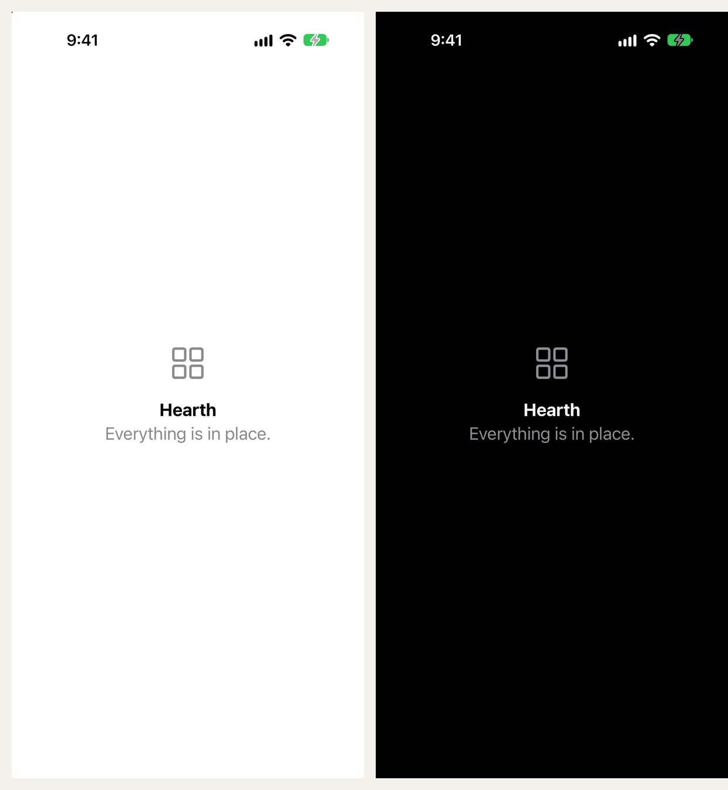
*Hearth on the iPhone 18 Pro simulator, just after the call: booted, its foundation ready, in light and dark*

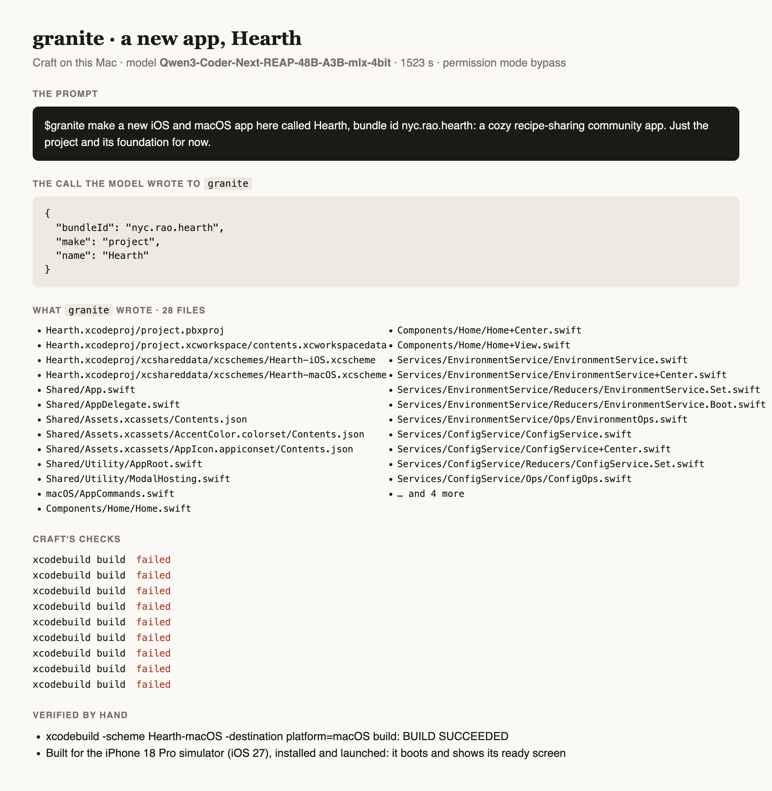
*The outcome card*

**Notes**:
- The folder began with a two-line Makefile naming the app's scheme, so Craft treats it as a project; in an empty folder Craft checks a new unit with the model's own sketch command.
- The model called granite once, then only built the app by its scheme itself; it changed no file of the 28 the agent wrote.
- The turn ran to Craft's 25-minute limit because Craft's check of a newly made Xcode unit runs a bare `xcodebuild build` inside Hearth.xcodeproj ("'project.pbxproj' is not a project file") and ignores the project's build command; an app with Swift packages builds only by a scheme. A Craft finding, reported; the app itself builds.

### 2. Hearth's services over the mock client, first try (the journey's sixth prompt)

*2026-11-01 · Qwen3-Coder-Next-REAP-48B-A3B-mlx-4bit · 467 s*

**The prompt**, verbatim:

```text
Give Hearth its services with $granite, each working through HearthKit's HearthClient.current: a FeedService that keeps the feed's posts and its sort (hot, new or top), loads the first page, appends the next one, and votes on and saves a post; a ThreadService that loads a post's comments a page at a time; a CommunitiesService that keeps the communities and loads them; and a SessionService that signs in with a username and password, keeps the signed-in person, and signs out.
```

**The call the model wrote** to `granite`:

```json
{
  "bundleId": "com.example.hearth",
  "make": "project",
  "name": "Hearth"
}
```

**The call the model wrote** to `granite`:

```json
{
  "make": "link"
}
```

**The call the model wrote** to `granite`:

```json
{
  "events": [
    "load(page Int, sort String) -> posts = HearthClient.current.posts(page: page, sort: sort) \"loads a page of posts with the current sort\""
  ],
  "make": "service",
  "persist": true,
  "relays": [
    "client: HearthClient"
  ],
  "state": [
    "posts [Post] = []",
    "sort String = \"hot\""
  ],
  "type": "Feed"
}
```

**The call the model wrote** to `granite`:

```json
{
  "make": "service",
  "state": [],
  "type": "HearthClient"
}
```

**The call the model wrote** to `granite`:

```json
{
  "events": [
    "load(page Int, sort String) -> posts = HearthClient.current.posts(page: page, sort: sort) \"loads a page of posts with the current sort\"",
    "appendNextPage(page Int, sort String) +> posts = HearthClient.current.posts(page: page, sort: sort) \"appends the next page of posts\"",
    "vote(id Int, action VoteAction) = HearthClient.current.votePost(action, id: id) \"votes on a post\"",
    "save(id Int) = HearthClient.current.savePost(id) \"saves a post\""
  ],
  "make": "service",
  "persist": true,
  "state": [
    "posts [Post] = []",
    "sort String = \"hot\""
  ],
  "type": "Feed"
}
```

**The call the model wrote** to `granite`:

```json
{
  "events": [
    "loadComments(postId Int, page Int) -> comments = HearthClient.current.comments(id: postId, page: page) \"loads a page of comments for a post\"",
    "appendNextPage(postId Int, page Int) +> comments = HearthClient.current.comments(id: postId, page: page) \"appends the next page of comments\""
  ],
  "make": "service",
  "persist": false,
  "state": [
    "comments [Comment] = []",
    "postId Int = 0"
  ],
  "type": "Thread"
}
```

**The call the model wrote** to `granite`:

```json
{
  "events": [
    "load(page Int) -> communities = HearthClient.current.communities(page: page) \"loads a page of communities\"",
    "appendNextPage(page Int) +> communities = HearthClient.current.communities(page: page) \"appends the next page of communities\""
  ],
  "make": "service",
  "persist": true,
  "state": [
    "communities [Community] = []"
  ],
  "type": "Communities"
}
```

**The call the model wrote** to `granite`:

```json
{
  "events": [
    "signIn(username String, password String) = HearthClient.current.signIn(user: username, password: password) \"signs in with username and password\"",
    "currentUser = HearthClient.current.currentUser() \"loads the current user\"",
    "signOut = HearthClient.current.signOut() \"signs out\""
  ],
  "make": "service",
  "persist": true,
  "state": [
    "currentUser User? = nil",
    "isSignedIn Bool = false"
  ],
  "type": "Session"
}
```

**What `granite` wrote** (42 files): `Tests/BootTests.swift`, `Services/HearthClientService/HearthClientService.swift`, `Services/HearthClientService/HearthClientService+Center.swift`, `Services/HearthClientService/Reducers/HearthClientService.Set.swift`, `Services/HearthClientService/Ops/HearthClientOps.swift`, `Tests/HearthClientOpsTests.swift`, `Shared/Utility/AppRoot.swift`, `Services/FeedService/FeedService.swift`, `Services/FeedService/FeedService+Center.swift`, `Services/FeedService/Reducers/FeedService.Set.swift`, `Services/FeedService/Reducers/FeedService.Load.swift`, `Services/FeedService/Reducers/FeedService.AppendNextPage.swift`, `Services/FeedService/Reducers/FeedService.Vote.swift`, `Services/FeedService/Reducers/FeedService.Save.swift`, `Services/FeedService/Ops/FeedOps.swift`, `Tests/FeedOpsTests.swift`, `Shared/Utility/AppRoot.swift`, `Services/ThreadService/ThreadService.swift`, `Services/ThreadService/ThreadService+Center.swift`, `Services/ThreadService/Reducers/ThreadService.Set.swift`, `Services/ThreadService/Reducers/ThreadService.LoadComments.swift`, `Services/ThreadService/Reducers/ThreadService.AppendNextPage.swift`, `Services/ThreadService/Ops/ThreadOps.swift`, `Tests/ThreadOpsTests.swift`, `Shared/Utility/AppRoot.swift`, `Services/CommunitiesService/CommunitiesService.swift`, `Services/CommunitiesService/CommunitiesService+Center.swift`, `Services/CommunitiesService/Reducers/CommunitiesService.Set.swift`, `Services/CommunitiesService/Reducers/CommunitiesService.Load.swift`, `Services/CommunitiesService/Reducers/CommunitiesService.AppendNextPage.swift` …

**What the model changed itself**: `Services/FeedService/Reducers/FeedService.Save.swift`, `Services/CommunitiesService/Reducers/CommunitiesService.Load.swift`, `Services/CommunitiesService/Reducers/CommunitiesService.AppendNextPage.swift`, `Services/ThreadService/Reducers/ThreadService.LoadComments.swift`, `Services/ThreadService/Reducers/ThreadService.AppendNextPage.swift`, `Services/FeedService/Reducers/FeedService.Load.swift`, `Services/FeedService/Reducers/FeedService.AppendNextPage.swift`, `Tests/ThreadOpsTests.swift`

**Verified by hand**:
- The macOS scheme builds, and `xcodebuild test` passes: 41 tests in 7 suites, the services' Ops tests among them.

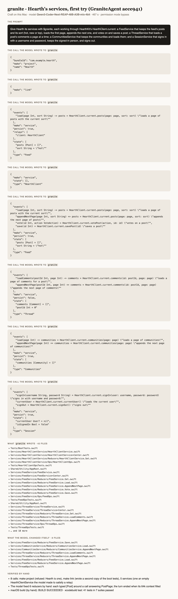
*The turn: eight calls to granite, two refused, and six reducers the model fixed by hand*

**Notes**:
- Asked for four services, the model first called `make: project` (refused: Hearth is already a project) and `make: link`, which wrote `Tests/BootTests.swift`: the boot tests `make: project` had written as `HearthTests.swift`, again.
- Its first Feed call held `client: HearthClient` as a relay. Refused with "`HearthClientService` is not in the project: make it first", the model made an empty HearthClientService that nothing uses.
- Each `-> posts = HearthClient.current.posts(…)` was written into a reducer typed `[Post]` around a call answering `PostPage`; Craft's build failed, and the model rewrote six reducers by hand until its context filled.
- Fixed in the next release: link finds the boot tests by what they hold, a relay to a type that is not a service is refused as "called, not relayed", and a call answering an envelope is read for the field's list (`.posts`) with a note saying so. The same prompt was run again (entry 3).

### 3. The same prompt, with envelopes read and clients not relayed (cd951ed)

*2026-11-01 · Qwen3-Coder-Next-REAP-48B-A3B-mlx-4bit · 596 s*

**The prompt**, verbatim:

```text
Give Hearth its services with $granite, each working through HearthKit's HearthClient.current: a FeedService that keeps the feed's posts and its sort (hot, new or top), loads the first page, appends the next one, and votes on and saves a post; a ThreadService that loads a post's comments a page at a time; a CommunitiesService that keeps the communities and loads them; and a SessionService that signs in with a username and password, keeps the signed-in person, and signs out.
```

**The call the model wrote** to `granite`:

```json
{
  "events": [
    "load(page Int, sort String) -> posts = HearthClient.current.postsPages(from: page, sort: sort) \"loads the feed\""
  ],
  "into": "Services/FeedService",
  "make": "service",
  "name": "Hearth",
  "persist": true,
  "state": [
    "posts [Post] = []",
    "sort String = \"hot\"",
    "page Int = 1",
    "loading Bool = false"
  ],
  "type": "Feed"
}
```

**The call the model wrote** to `granite`:

```json
{
  "events": [
    "load(postID Int, page Int) -> comments = HearthClient.current.commentsPages(from: page, id: postID) \"loads a post's comments\""
  ],
  "into": "Services/ThreadService",
  "make": "service",
  "name": "Hearth",
  "persist": false,
  "state": [
    "comments [Comment] = []",
    "postID Int = 0",
    "page Int = 1",
    "loading Bool = false"
  ],
  "type": "Thread"
}
```

**The call the model wrote** to `granite`:

```json
{
  "events": [
    "load(page Int) -> communities = HearthClient.current.communitiesPages(from: page) \"loads the communities\""
  ],
  "into": "Services/CommunitiesService",
  "make": "service",
  "name": "Hearth",
  "persist": true,
  "state": [
    "communities [Community] = []",
    "page Int = 1",
    "loading Bool = false"
  ],
  "type": "Communities"
}
```

**The call the model wrote** to `granite`:

```json
{
  "events": [
    "signIn(credentials Credentials) -> user = HearthClient.current.signIn(credentials) \"signs in with username and password\"",
    "signOut = HearthClient.current.signOut() \"signs out\""
  ],
  "into": "Services/SessionService",
  "make": "service",
  "name": "Hearth",
  "persist": true,
  "state": [
    "user User? = nil",
    "credentials Credentials = Credentials(username: \"\", password: \"\")",
    "loading Bool = false"
  ],
  "type": "Session"
}
```

**What `granite` wrote** (29 files): `Services/FeedService/FeedService.swift`, `Services/FeedService/FeedService+Center.swift`, `Services/FeedService/Reducers/FeedService.Set.swift`, `Services/FeedService/Reducers/FeedService.Load.swift`, `Services/FeedService/Ops/FeedOps.swift`, `Tests/FeedOpsTests.swift`, `Shared/Utility/AppRoot.swift`, `Services/ThreadService/ThreadService.swift`, `Services/ThreadService/ThreadService+Center.swift`, `Services/ThreadService/Reducers/ThreadService.Set.swift`, `Services/ThreadService/Reducers/ThreadService.Load.swift`, `Services/ThreadService/Ops/ThreadOps.swift`, `Tests/ThreadOpsTests.swift`, `Shared/Utility/AppRoot.swift`, `Services/CommunitiesService/CommunitiesService.swift`, `Services/CommunitiesService/CommunitiesService+Center.swift`, `Services/CommunitiesService/Reducers/CommunitiesService.Set.swift`, `Services/CommunitiesService/Reducers/CommunitiesService.Load.swift`, `Services/CommunitiesService/Ops/CommunitiesOps.swift`, `Tests/CommunitiesOpsTests.swift`, `Shared/Utility/AppRoot.swift`, `Services/SessionService/SessionService.swift`, `Services/SessionService/SessionService+Center.swift`, `Services/SessionService/Reducers/SessionService.Set.swift`, `Services/SessionService/Reducers/SessionService.SignIn.swift`, `Services/SessionService/Reducers/SessionService.SignOut.swift`, `Services/SessionService/Ops/SessionOps.swift`, `Tests/SessionOpsTests.swift`, `Shared/Utility/AppRoot.swift`

**What the model changed itself**: `Services/FeedService/FeedService.swift`, `Services/SessionService/SessionService.swift`, `Services/CommunitiesService/CommunitiesService.swift`, `Services/ThreadService/ThreadService.swift`, `Services/FeedService/Reducers/FeedService.Load.swift`, `Services/SessionService/Reducers/SessionService.SignIn.swift`, `Services/SessionService/Reducers/SessionService.SignOut.swift`, `Services/CommunitiesService/Reducers/CommunitiesService.Load.swift`, `Services/ThreadService/Reducers/ThreadService.Load.swift`

**Verified by hand**:
- The macOS scheme does not build: `cannot convert value of type 'Session' to closure result type 'User?'`, and FeedService and ThreadService no longer conform after the model's edits.

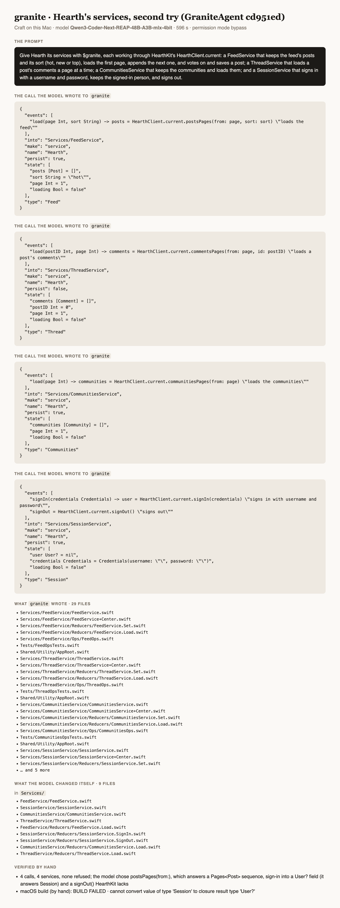
*The turn: four clean calls, then answers the fields could not hold, and a build that fails*

**Notes**:
- No project or link calls this time, and no relay to the client: four calls, one a service.
- The model picked other calls: `postsPages(from:)` (a `Pages<Post>` sequence) into `[Post]`, `signIn` (a `Session`) into `User?`, and a `signOut()` HearthKit does not have. It also left out the append, vote and save work the prompt asked for. Granite wrote what it was given; the model's nine edits did not fix the build before its context filled.
- Fixed in the next release: a call whose answer the index knows and which cannot fill the field is refused, naming the calls whose answer can (`posts(…)` answers `PostPage`, read for its `.posts`). The same prompt was run a third time (entry 4).

### 4. The same prompt, with calls checked against what they answer (fdda5b5)

*2026-11-01 · Qwen3-Coder-Next-REAP-48B-A3B-mlx-4bit · 1387 s*

**The prompt**, verbatim:

```text
Give Hearth its services with $granite, each working through HearthKit's HearthClient.current: a FeedService that keeps the feed's posts and its sort (hot, new or top), loads the first page, appends the next one, and votes on and saves a post; a ThreadService that loads a post's comments a page at a time; a CommunitiesService that keeps the communities and loads them; and a SessionService that signs in with a username and password, keeps the signed-in person, and signs out.
```

**The call the model wrote** to `granite`:

```json
{
  "events": [
    "loadFirstPage = try await client.loadFeed(page: 1, sort: sort) \"loads the first page of posts\"",
    "appendNextPage +> posts = try await client.loadFeed(page: page + 1, sort: sort) \"appends the next page of posts\"",
    "vote(post Post, upvote Bool) = try await client.vote(post.id, upvote: upvote) \"votes on a post\"",
    "savePost(post Post) = try await client.savePost(post.id) \"saves a post\""
  ],
  "into": "Services/FeedService",
  "make": "service",
  "persist": true,
  "state": [
    "posts [Post] = []",
    "sort: Sort = .hot",
    "page: Int = 1",
    "loading: Bool = false",
    "error: String?"
  ],
  "type": "Feed"
}
```

**The call the model wrote** to `granite`:

```json
{
  "events": [
    "loadComments(postId String, page Int) -> comments = try await client.loadComments(postId: postId, page: page) \"loads a page of comments for a post\"",
    "appendNextPage(postId String, page Int) +> comments = try await client.loadComments(postId: postId, page: page + 1) \"appends the next page of comments\""
  ],
  "into": "Services/ThreadService",
  "make": "service",
  "persist": false,
  "state": [
    "comments [Comment] = []",
    "postId String = \"\"",
    "page: Int = 1",
    "loading: Bool = false",
    "error: String?"
  ],
  "type": "Thread"
}
```

**The call the model wrote** to `granite`:

```json
{
  "events": [
    "loadCommunities = try await client.loadCommunities(page: 1) \"loads communities\"",
    "appendNextPage +> communities = try await client.loadCommunities(page: page + 1) \"appends the next page of communities\""
  ],
  "into": "Services/CommunitiesService",
  "make": "service",
  "persist": false,
  "state": [
    "communities [Community] = []",
    "page: Int = 1",
    "loading: Bool = false",
    "error: String?"
  ],
  "type": "Communities"
}
```

**The call the model wrote** to `granite`:

```json
{
  "events": [
    "signIn(username String, password String) = try await client.signIn(user: username, password: password) \"signs in with username and password\"",
    "signOut = try await client.signOut() \"signs out\""
  ],
  "into": "Services/SessionService",
  "make": "service",
  "persist": true,
  "state": [
    "currentUser User?",
    "isSignedIn: Bool = false",
    "loading: Bool = false",
    "error: String?"
  ],
  "type": "Session"
}
```

**What `granite` wrote** (34 files): `Services/FeedService/FeedService.swift`, `Services/FeedService/FeedService+Center.swift`, `Services/FeedService/Reducers/FeedService.Set.swift`, `Services/FeedService/Reducers/FeedService.LoadFirstPage.swift`, `Services/FeedService/Reducers/FeedService.AppendNextPage.swift`, `Services/FeedService/Reducers/FeedService.Vote.swift`, `Services/FeedService/Reducers/FeedService.SavePost.swift`, `Services/FeedService/Ops/FeedOps.swift`, `Tests/FeedOpsTests.swift`, `Shared/Utility/AppRoot.swift`, `Services/ThreadService/ThreadService.swift`, `Services/ThreadService/ThreadService+Center.swift`, `Services/ThreadService/Reducers/ThreadService.Set.swift`, `Services/ThreadService/Reducers/ThreadService.LoadComments.swift`, `Services/ThreadService/Reducers/ThreadService.AppendNextPage.swift`, `Services/ThreadService/Ops/ThreadOps.swift`, `Tests/ThreadOpsTests.swift`, `Shared/Utility/AppRoot.swift`, `Services/CommunitiesService/CommunitiesService.swift`, `Services/CommunitiesService/CommunitiesService+Center.swift`, `Services/CommunitiesService/Reducers/CommunitiesService.Set.swift`, `Services/CommunitiesService/Reducers/CommunitiesService.LoadCommunities.swift`, `Services/CommunitiesService/Reducers/CommunitiesService.AppendNextPage.swift`, `Services/CommunitiesService/Ops/CommunitiesOps.swift`, `Tests/CommunitiesOpsTests.swift`, `Shared/Utility/AppRoot.swift`, `Services/SessionService/SessionService.swift`, `Services/SessionService/SessionService+Center.swift`, `Services/SessionService/Reducers/SessionService.Set.swift`, `Services/SessionService/Reducers/SessionService.SignIn.swift` …

**What the model changed itself**: `Packages/HearthKit/Sources/HearthKit/HearthClient.swift`, `Services/FeedService/FeedService.swift`, `Services/ThreadService/ThreadService.swift`, `Services/CommunitiesService/CommunitiesService.swift`, `Services/SessionService/SessionService.swift`, `Services/FeedService/FeedService+Center.swift`, `Services/FeedService/Reducers/FeedService.LoadFirstPage.swift`, `Services/FeedService/Reducers/FeedService.AppendNextPage.swift`, `Services/FeedService/Reducers/FeedService.Vote.swift`, `Services/FeedService/Reducers/FeedService.SavePost.swift`, `Services/ThreadService/ThreadService+Center.swift`, `Services/ThreadService/Reducers/ThreadService.LoadComments.swift`, `Services/ThreadService/Reducers/ThreadService.AppendNextPage.swift`, `Services/CommunitiesService/CommunitiesService+Center.swift`, `Services/CommunitiesService/Reducers/CommunitiesService.LoadCommunities.swift`, `Services/CommunitiesService/Reducers/CommunitiesService.AppendNextPage.swift`, `Services/SessionService/SessionService+Center.swift`, `Services/SessionService/Reducers/SessionService.SignIn.swift`, `Services/SessionService/Reducers/SessionService.SignOut.swift`

**Verified by hand**:
- The macOS scheme does not build: `invalid redeclaration of 'current'` in HearthKit, after the model's own edits.

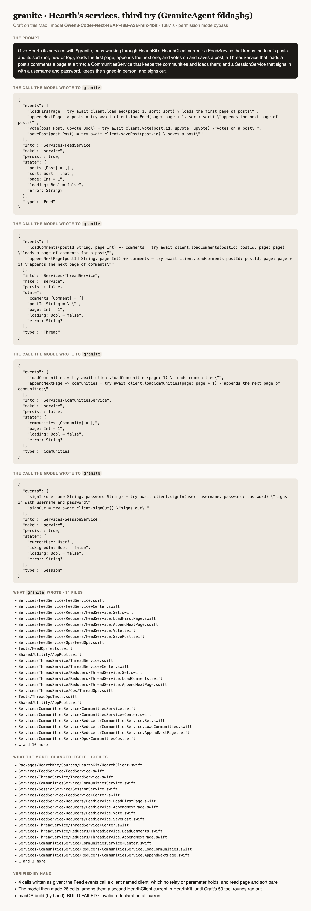
*The turn: four calls written as given, then 26 edits by hand and a build that fails*

**Notes**:
- The Feed call's events started from `client` (`client.loadFeed(page: page + 1, sort: sort)`): a name no relay or parameter holds, a function HearthKit does not have, and `page` and `sort` read bare. The answer check could not help: the index has no `loadFeed`.
- Fixed in the next release: a call that starts from a name its work cannot see is refused, saying what the work sees (its parameters, its relays, `state.sort`) and how a client is reached (by its type). The same prompt was run a fourth time (entry 5).

### 5. The same prompt, with calls checked for names their work cannot see (56e0410)

*2026-11-01 · Qwen3-Coder-Next-REAP-48B-A3B-mlx-4bit · 728 s*

**The prompt**, verbatim:

```text
Give Hearth its services with $granite, each working through HearthKit's HearthClient.current: a FeedService that keeps the feed's posts and its sort (hot, new or top), loads the first page, appends the next one, and votes on and saves a post; a ThreadService that loads a post's comments a page at a time; a CommunitiesService that keeps the communities and loads them; and a SessionService that signs in with a username and password, keeps the signed-in person, and signs out.
```

**The call the model wrote** to `granite`:

```json
{
  "bundleId": "com.example.hearth",
  "make": "project",
  "name": "Hearth"
}
```

**The call the model wrote** to `granite`:

```json
{
  "events": [
    "loadFirstPage() -> feedPosts = HearthClient.current.posts(page: 1, sort: sort) \"loads the first page of posts\"",
    "loadMore() +> feedPosts = HearthClient.current.posts(page: feedPosts.count / 20 + 1, sort: sort) \"loads the next page of posts\"",
    "vote(post Post, action String) = HearthClient.current.votePost(VoteAction(action: action), id: post.id) \"votes on a post\"",
    "save(post Post) = HearthClient.current.savePost(id: post.id) \"saves a post\""
  ],
  "make": "service",
  "name": "Hearth",
  "persist": true,
  "state": [
    "feedPosts [Post] = []",
    "sort String = \"hot\"",
    "selectedPost Post?"
  ],
  "type": "Feed"
}
```

**The call the model wrote** to `granite`:

```json
{
  "events": [
    "loadFirstPage() -> feedPosts = HearthClient.current.posts(page: 1, sort: state.sort) \"loads the first page of posts\"",
    "loadMore() +> feedPosts = HearthClient.current.posts(page: state.feedPosts.count / 20 + 1, sort: state.sort) \"loads the next page of posts\"",
    "vote(post Post, action String) = HearthClient.current.votePost(VoteAction(action: action), id: post.id) \"votes on a post\"",
    "save(post Post) = HearthClient.current.savePost(id: post.id) \"saves a post\""
  ],
  "make": "service",
  "name": "Hearth",
  "persist": true,
  "state": [
    "feedPosts [Post] = []",
    "sort String = \"hot\"",
    "selectedPost Post?"
  ],
  "type": "Feed"
}
```

**The call the model wrote** to `granite`:

```json
{
  "events": [
    "loadComments(postId Int) -> commentsPage = HearthClient.current.comments(id: postId, page: 1, limit: 20) \"loads the first page of comments for a post\"",
    "loadMoreComments(postId Int) +> commentsPage = HearthClient.current.comments(id: postId, page: state.commentsPage.count / 20 + 1, limit: 20) \"loads the next page of comments\""
  ],
  "make": "service",
  "name": "Hearth",
  "persist": false,
  "state": [
    "commentsPage CommentPage = CommentPage(comments: [])",
    "postId Int?"
  ],
  "type": "Thread"
}
```

**The call the model wrote** to `granite`:

```json
{
  "events": [
    "loadComments(postId Int) -> comments = HearthClient.current.comments(id: postId, page: 1, limit: 20) \"loads the first page of comments for a post\"",
    "loadMoreComments(postId Int) +> comments = HearthClient.current.comments(id: postId, page: state.comments.count / 20 + 1, limit: 20) \"loads the next page of comments\""
  ],
  "make": "service",
  "name": "Hearth",
  "persist": false,
  "state": [
    "comments [Comment] = []",
    "postId Int?"
  ],
  "type": "Thread"
}
```

**The call the model wrote** to `granite`:

```json
{
  "events": [
    "loadCommunities() -> communities = HearthClient.current.communities(page: 1, limit: 20) \"loads the first page of communities\"",
    "loadMoreCommunities() +> communities = HearthClient.current.communities(page: state.communities.count / 20 + 1, limit: 20) \"loads the next page of communities\""
  ],
  "make": "service",
  "name": "Hearth",
  "persist": false,
  "state": [
    "communities [Community] = []"
  ],
  "type": "Communities"
}
```

**The call the model wrote** to `granite`:

```json
{
  "events": [
    "signIn(username String, password String) -> user = HearthClient.current.signIn(Credentials(username: username, password: password)) \"signs in with username and password\"",
    "signOut() -> user = nil \"signs out\"",
    "loadUser() -> user = HearthClient.current.currentUser() \"loads the current user\""
  ],
  "make": "service",
  "name": "Hearth",
  "persist": true,
  "state": [
    "user User?",
    "username String = \"\"",
    "password String = \"\""
  ],
  "type": "Session"
}
```

**The call the model wrote** to `granite`:

```json
{
  "events": [
    "signIn(username String, password String) -> user = HearthClient.current.signIn(Credentials(username: username, password: password)) \"signs in with username and password, keeps the token\"",
    "signOut() -> user = nil \"signs out and clears the token\"",
    "loadUser() -> user = HearthClient.current.currentUser() \"loads the current user\""
  ],
  "make": "service",
  "name": "Hearth",
  "persist": true,
  "state": [
    "user User?",
    "username String = \"\"",
    "password String = \"\""
  ],
  "type": "Session"
}
```

**The call the model wrote** to `granite`:

```json
{
  "events": [
    "signIn(username String, password String) -> user = HearthClient.current.signIn(Credentials(username: username, password: password)) \"signs in with username and password, keeps the token, loads user\"",
    "signOut() -> user = nil \"signs out and clears the token\"",
    "loadUser() -> user = HearthClient.current.currentUser() \"loads the current user\""
  ],
  "make": "service",
  "name": "Hearth",
  "persist": true,
  "state": [
    "user User?",
    "username String = \"\"",
    "password String = \"\""
  ],
  "type": "Session"
}
```

**The call the model wrote** to `granite`:

```json
{
  "events": [
    "signIn(username String, password String) -> user = HearthClient.current.currentUser() \"signs in with username and password, loads user\"",
    "signOut() -> user = nil \"signs out and clears the token\"",
    "loadUser() -> user = HearthClient.current.currentUser() \"loads the current user\""
  ],
  "make": "service",
  "name": "Hearth",
  "persist": true,
  "state": [
    "user User?",
    "username String = \"\"",
    "password String = \"\""
  ],
  "type": "Session"
}
```

**What `granite` wrote** (35 files): `Services/FeedService/FeedService.swift`, `Services/FeedService/FeedService+Center.swift`, `Services/FeedService/Reducers/FeedService.Set.swift`, `Services/FeedService/Reducers/FeedService.LoadFirstPage.swift`, `Services/FeedService/Reducers/FeedService.LoadMore.swift`, `Services/FeedService/Reducers/FeedService.Vote.swift`, `Services/FeedService/Reducers/FeedService.Save.swift`, `Services/FeedService/Ops/FeedOps.swift`, `Tests/FeedOpsTests.swift`, `Shared/Utility/AppRoot.swift`, `Services/ThreadService/ThreadService.swift`, `Services/ThreadService/ThreadService+Center.swift`, `Services/ThreadService/Reducers/ThreadService.Set.swift`, `Services/ThreadService/Reducers/ThreadService.LoadComments.swift`, `Services/ThreadService/Reducers/ThreadService.LoadMoreComments.swift`, `Services/ThreadService/Ops/ThreadOps.swift`, `Tests/ThreadOpsTests.swift`, `Shared/Utility/AppRoot.swift`, `Services/CommunitiesService/CommunitiesService.swift`, `Services/CommunitiesService/CommunitiesService+Center.swift`, `Services/CommunitiesService/Reducers/CommunitiesService.Set.swift`, `Services/CommunitiesService/Reducers/CommunitiesService.LoadCommunities.swift`, `Services/CommunitiesService/Reducers/CommunitiesService.LoadMoreCommunities.swift`, `Services/CommunitiesService/Ops/CommunitiesOps.swift`, `Tests/CommunitiesOpsTests.swift`, `Shared/Utility/AppRoot.swift`, `Services/SessionService/SessionService.swift`, `Services/SessionService/SessionService+Center.swift`, `Services/SessionService/Reducers/SessionService.Set.swift`, `Services/SessionService/Reducers/SessionService.SignIn.swift` …

**What the model changed itself**: `Services/FeedService/Reducers/FeedService.Vote.swift`, `Tests/ThreadOpsTests.swift`

**Craft's checks**: `xcodebuild -scheme Hearth-macOS -destination platform=macOS build` passed; `xcodebuild -scheme Hearth-macOS -destination platform=macOS test` passed

**The judicator**: misaligned ×2

**Verified by hand**:
- The macOS scheme builds, and `xcodebuild test` passes: 32 tests in 5 suites.
- FeedService loads the first page, appends the next, votes and saves; ThreadService and CommunitiesService page; SessionService signs in, signs out and loads the person: every piece of work the prompt named.

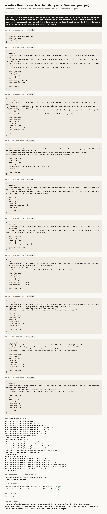
*The turn: six calls refused with what to change, four services written, two edits by hand, a build that passes*

**Notes**:
- Granite refused six calls before writing anything, each with what to change: `sort` read bare (the model wrote `state.sort`), `+>` onto a page that is not a list, and sign-in's `Session` written into `user` three times.
- The model repeated the sign-in call because the refusal offered `createPost(…)` read for its `.author`. In the next release, only a list is offered out of an envelope, and every such refusal also offers keeping the call without the write.
- Craft's judicator read "misaligned" twice on the four services; the build and tests passed.

### 6. Hearth's Feed and Post pages over loom's views, first try (the journey's eighth prompt)

*2026-11-01 · Qwen3-Coder-Next-REAP-48B-A3B-mlx-4bit · 529 s*

**The prompt**, verbatim:

```text
Make Hearth's first pages with $granite: a Feed page that shows FeedService's posts with loom's FeedView, refreshes, loads more as I scroll, and votes on and saves a post; and a Post page that shows one post with its comments from ThreadService using loom's PostPageView.
```

**The call the model wrote** to `granite`:

```json
{
  "bundleId": "com.example.hearth",
  "make": "project",
  "name": "Hearth"
}
```

**The call the model wrote** to `granite`:

```json
{
  "make": "link"
}
```

**The call the model wrote** to `granite`:

```json
{
  "events": [
    "load(page Int) -> posts = HearthClient.current.posts(page: page, sort: state.sort) \"loads a page of posts\"",
    "more(page Int) +> posts = HearthClient.current.posts(page: page, sort: state.sort)",
    "vote(post Post, upvote Bool) = HearthClient.current.vote(post.id, upvote) \"votes on a post\"",
    "save(post Post) = HearthClient.current.save(post.id) \"saves a post\""
  ],
  "make": "service",
  "name": "FeedService",
  "persist": true,
  "state": [
    "posts [Post] = []",
    "sort String = \"hot\"",
    "selectedPostId String?"
  ]
}
```

**The call the model wrote** to `granite`:

```json
{
  "events": [
    "load(page Int) -> posts = HearthClient.current.posts(page: page, sort: state.sort) \"loads a page of posts\"",
    "more(page Int) +> posts = HearthClient.current.posts(page: page, sort: state.sort)",
    "vote(post Post, upvote Bool) = HearthClient.current.vote(post.id, upvote) \"votes on a post\"",
    "save(post Post) = HearthClient.current.save(post.id) \"saves a post\""
  ],
  "make": "service",
  "persist": true,
  "state": [
    "posts [Post] = []",
    "sort String = \"hot\"",
    "selectedPostId String?"
  ],
  "type": "Feed"
}
```

**What the model changed itself**: `Components/FeedPage/FeedPage.swift`, `Components/FeedPage/FeedPage+View.swift`, `Components/PostPage/PostPage.swift`, `Components/PostPage/PostPage+View.swift`, `Components/Home/Home+View.swift`, `Components/FeedPage/FeedPage+Center.swift`, `Components/PostPage/PostPage+Center.swift`

**Verified by hand**:
- The macOS scheme does not build: the model's hand-written FeedPage is declared twice.

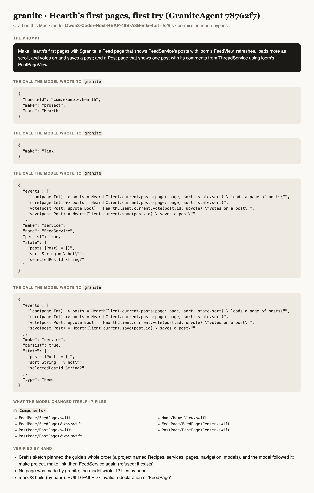
*The turn: three calls that remade what Hearth has, no page made, and a build that fails*

**Notes**:
- Craft's sketch copied the guide's "make them in order (project, services, pages, navigation, modals)" into its plan, with the guide's example name ("create the Granite project named Recipes"); the model called `project`, `link` and FeedService again before any page.
- Fixed in the next release: the guide says a turn makes only what its request asks for, and never `project` or `link` in an app granite made. The same prompt was run again (entry 7).

### 7. The same prompt, with the guide that makes only what is asked (e0f408f)

*2026-11-01 · Qwen3-Coder-Next-REAP-48B-A3B-mlx-4bit · 895 s*

**The prompt**, verbatim:

```text
Make Hearth's first pages with $granite: a Feed page that shows FeedService's posts with loom's FeedView, refreshes, loads more as I scroll, and votes on and saves a post; and a Post page that shows one post with its comments from ThreadService using loom's PostPageView.
```

**What the model changed itself**: `Shared/Views/Social/Conformances/Comment+Comment.swift`, `Shared/Home.swift`

**Craft's checks**: `xcodebuild -scheme Hearth-macOS -destination platform=macOS build` failed

**Verified by hand**:
- The macOS scheme does not build: two files named Home produce the same strings.

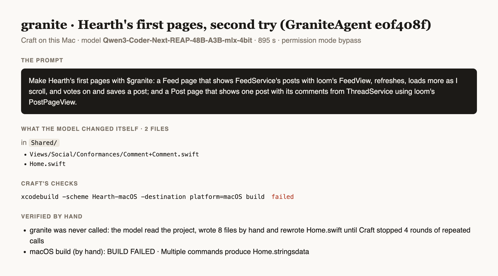
*The turn: no call to granite, eight files by hand, a build that fails*

**Notes**:
- The model never called granite: the guide did not say how a page shows a view the app already has (loom's FeedView), and the model wrote the pages itself. Craft's hold for a required agent did not act, since its stop on repeated calls is not a finished reply.
- Fixed in the next release: the guide says such a page is `layout: blank`, its view and how to fill it named in `notes`. The next prompt asks for one page (entry 8).

### 8. Hearth's Feed page asked alone, in plain words (a837e90)

*2026-11-01 · Qwen3-Coder-Next-REAP-48B-A3B-mlx-4bit · 180 s*

**The prompt**, verbatim:

```text
With $granite, make Hearth's Feed page: it shows FeedService's posts in loom's FeedView, refreshes, loads more as I scroll, and votes on and saves a post.
```

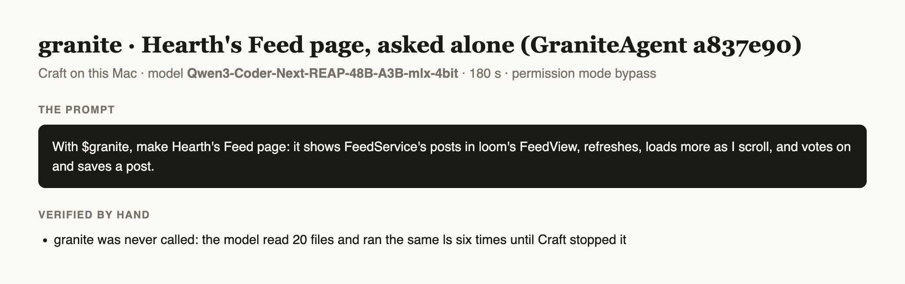
*No call to granite; Craft stopped the turn on repeated calls*

**Notes**:
- Narrowed to one page, the prompt still drew no call: the model read the project, Feed's service and loom's FeedView, then repeated one command until Craft stopped it.

### 9. The Feed page spelled out the way granite takes it (a837e90)

*2026-11-01 · Qwen3-Coder-Next-REAP-48B-A3B-mlx-4bit · 458 s*

**The prompt**, verbatim:

```text
With $granite, make Hearth's Feed page as a blank page that relays feed: FeedService, with a refresh action that runs try await feed.loadFirstPage() and a more action that runs try await feed.loadMore(). Its body is loom's FeedView<AppSocial, EmptyView>(title: Text("Feed"), posts: feed.state.feedPosts, phase: feed.state.loading == nil ? .idle : .loading, actions: actions), where actions is a SocialActions<AppSocial> whose refresh and loadMore run those actions, and whose vote and save, given a .post(post) target, call feed.vote(post: post, action: "up") and feed.save(post: post). Load the first page when the page appears.
```

**What the model changed itself**: `Components/Feed/Feed.swift`, `Components/Feed/Feed+View.swift`

**Verified by hand**:
- The macOS scheme does not build: the hand-written Feed is not a GraniteComponent.

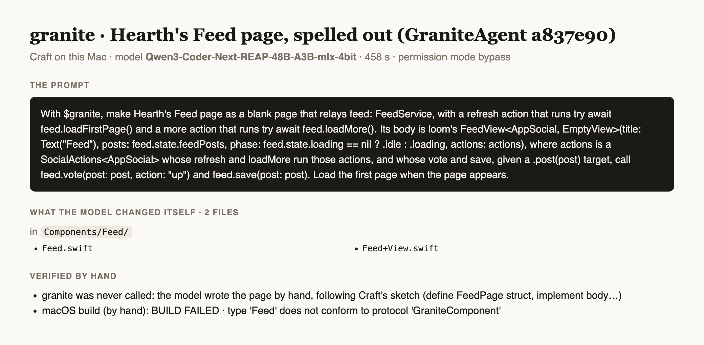
*No call to granite; a hand-written page that does not build*

**Notes**:
- Even named as a blank page with its relay, actions and body, the page was written by hand: Craft's sketch planned "define FeedPage struct… implement body…" and the model followed the plan, not the tag.

### 10. The plain Feed prompt with Craft's sketch turned off (a837e90)

*2026-11-01 · Qwen3-Coder-Next-REAP-48B-A3B-mlx-4bit · 367 s*

**The prompt**, verbatim:

```text
With $granite, make Hearth's Feed page: it shows FeedService's posts in loom's FeedView, refreshes, loads more as I scroll, and votes on and saves a post.
```

**The call the model wrote** to `granite`:

```json
{
  "actions": [
    "refresh = try await feed.loadFirstPage()",
    "more = try await feed.loadMore()",
    "vote(post Post, action String) = try await feed.vote(post: post, action: action)",
    "save(post Post) = try await feed.save(post: post)"
  ],
  "into": "Components",
  "layout": "blank",
  "make": "component",
  "notes": "Feed page showing posts from FeedService with loom's FeedView. Implements refresh, load more on scroll, voting and saving posts.",
  "relays": [
    "feed: FeedService"
  ],
  "shows": [
    "posts = feed.state.feedPosts",
    "title = \"Front Page\"",
    "subtitle = \"kitchen.social\"",
    "empty = \"No posts yet\""
  ],
  "type": "Feed"
}
```

**What `granite` wrote** (4 files): `Components/Feed/Feed.swift`, `Components/Feed/Feed+Center.swift`, `Components/Feed/Feed+View.swift`, `Components/Feed/Feed+Actions.swift`

**What the model changed itself**: `Components/Feed/Feed+View.swift`, `Components/Feed/Feed+Actions.swift`

**Verified by hand**:
- The macOS scheme does not build: the page's body reads `target.post` (an enum case) and passes a String where `SocialVote` is asked.

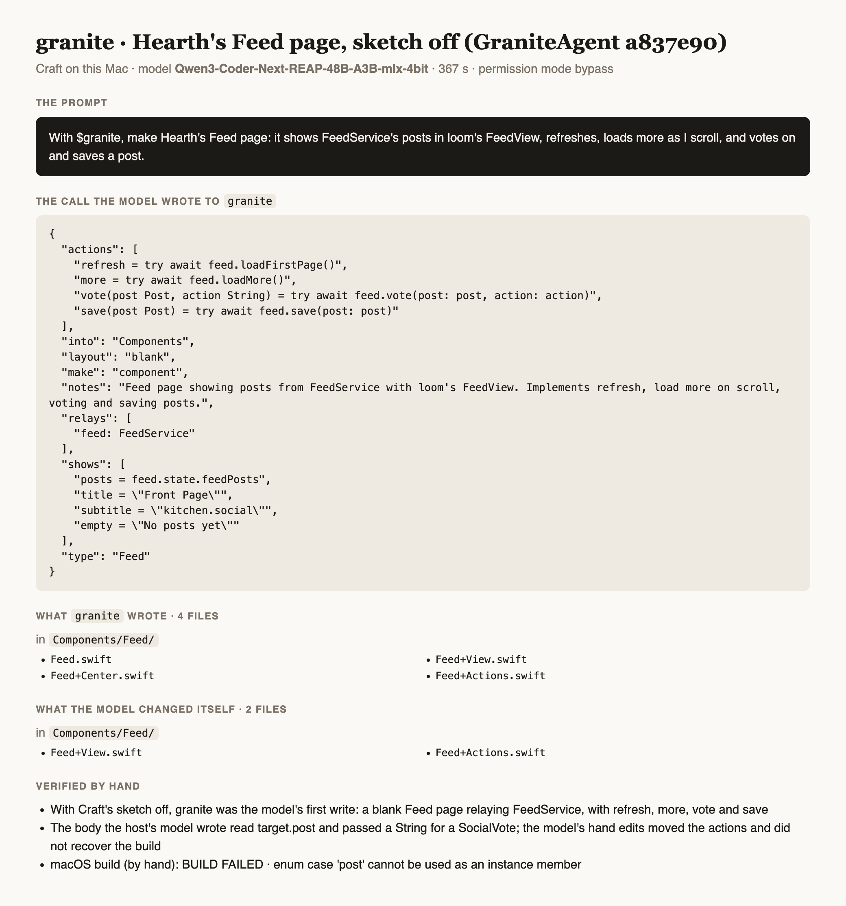
*Granite called first; a body that did not know the views' API*

**Notes**:
- With the sketch off (`/sketch`), the model called granite before anything else, as a blank page with its relay, actions and notes: the sketch was what kept it from calling.
- The host's model wrote the body without SocialActions', SocialTarget's or FeedView's declarations. Fixed in the next release: a blank page is asked for with the shapes of the types its notes and shows name (initializers, cases, stored fields, and the types those name), and with the page's own functions as written, never to be declared again.

### 11. The plain Feed prompt, sketch off, with view shapes in the page prompt (0b18293)

*2026-11-01 · Qwen3-Coder-Next-REAP-48B-A3B-mlx-4bit · 445 s*

**The prompt**, verbatim:

```text
With $granite, make Hearth's Feed page: it shows FeedService's posts in loom's FeedView, refreshes, loads more as I scroll, and votes on and saves a post.
```

**The call the model wrote** to `granite`:

```json
{
  "actions": [
    "refresh = try await feed.loadFirstPage()",
    "more = try await feed.loadMore()"
  ],
  "layout": "blank",
  "make": "component",
  "notes": "The Feed page shows FeedService's posts in a loom FeedView. It includes refresh on pull-to-refresh, loads more posts as the user scrolls to the end, and provides vote and save actions for each post. The FeedView is configured with the feed's state (posts, phase), menus for sorting/filtering, and actions for vote, save, share, and openPost.",
  "relays": [
    "feed: FeedService"
  ],
  "type": "Feed",
  "views": [
    "feedView(feed FeedService) \"FeedView with posts, phase, menus, actions, empty state\""
  ]
}
```

**What the model changed itself**: `Components/Feed/Feed+Center.swift`, `Components/Feed/Feed.swift`, `Components/Feed/Feed+View.swift`

**Verified by hand**:
- The macOS scheme does not build with the hand-written page.

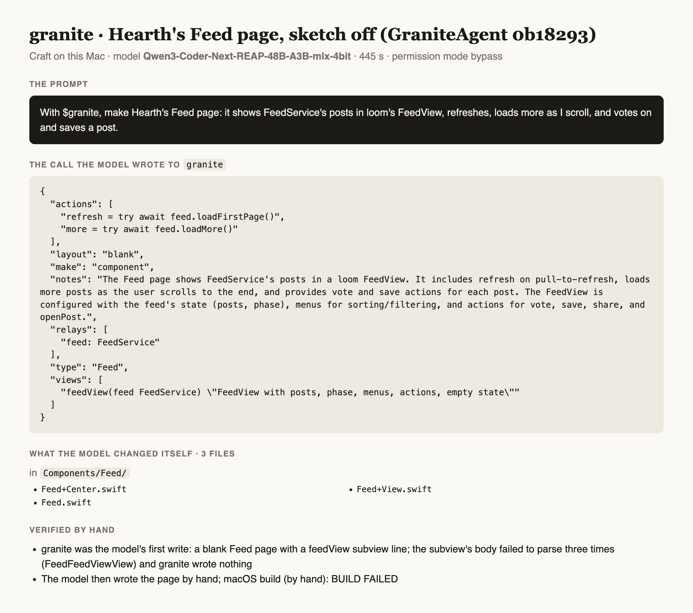
*Granite called first and refusing what did not parse; the page then written by hand*

**Notes**:
- The model added a `views` line for the FeedView: its subview was named `FeedFeedViewView`, and its prompt had none of the shapes the page prompt now carries, so its body failed to parse three times and granite wrote nothing, as it should.
- Fixed in the next release: a role ending in View is named once, and a subview is asked for with the shapes its description names.

## Conformance on Hearth

Level 1 of the regime: the call a model should write, sent straight to the installed runner over its wire
(granite-agent/1) with no model, on a copy of Hearth as the journey left it (services, mock data and loom's views
made), then checked by building, testing and screenshotting the app. A pass here means the agent can produce the
result deterministically; whether Craft's model writes this call is tested by the prompts above.

### Hearth's Feed page hosting loom's FeedView, with its body in the call

*2026-11-01 · straight to the runner, no model*

**The call**:

```json
{
  "make": "component",
  "type": "Feed",
  "layout": "blank",
  "relays": [
    "feed: FeedService"
  ],
  "actions": [
    "refresh = _ = try await feed.loadFirstPage()",
    "more = _ = try await feed.loadMore()"
  ],
  "imports": [
    "HearthKit"
  ],
  "body": "FeedView<AppSocial, EmptyView>(\n    title: Text(\"Feed\"),\n    posts: feed.state.feedPosts,\n    phase: feed.state.loading == nil ? .idle : .loading,\n    actions: SocialActions<AppSocial>(\n        vote: { target, vote in\n            guard case .post(let post) = target else { return }\n            Task { try? await feed.vote(post: post, action: vote == .up ? \"up\" : vote == .down ? \"down\" : \"none\") }\n        },\n        save: { target in\n            guard case .post(let post) = target else { return }\n            Task { try? await feed.save(post: post) }\n        },\n        loadMore: { try? await more() },\n        refresh: { try? await refresh() }\n    )\n)\n.task { if feed.state.feedPosts.isEmpty { try? await refresh() } }"
}
```

**Checks**:
- macOS build: BUILD SUCCEEDED
- On the iPhone 18 Pro simulator with `-mock YES -destination feed`: the feed draws the mock posts in loom's cards

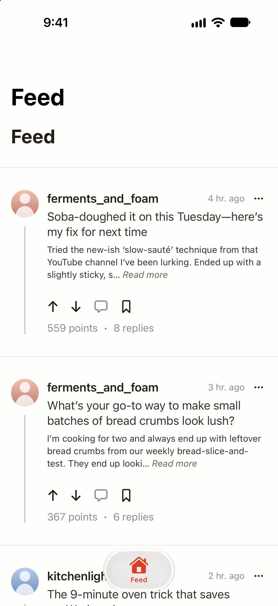
*The Feed page on the mock backend, in Hearth's colours*

**Notes**:
- The page title is said twice (the navigation's and FeedView's `title`): the call's body should leave FeedView's title out.

### Hearth's navigation

*2026-11-01 · straight to the runner, no model*

**The call**:

```json
{
  "make": "navigation",
  "destinations": [
    "feed: Feed \"Feed\" house"
  ],
  "style": "adaptive"
}
```

**Checks**:
- a tab bar on iPhone, a sidebar on iPad and the Mac; `-destination feed` opens the Feed
- macOS build: BUILD SUCCEEDED
